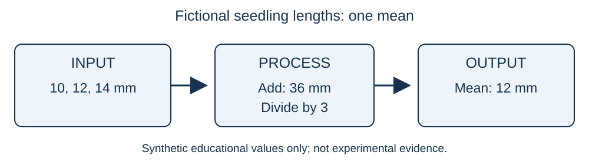
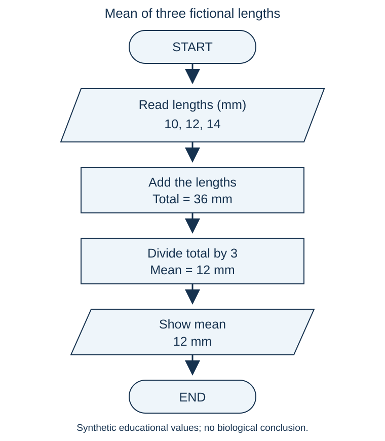

# Session 01: from a problem to a program

## 00-10: Why programming helps

Programming means writing precise instructions a computer can follow. A computer does not understand an unclear request such as "analyze this sample". We must say what information to use, what steps to take and what result to show.

Biologists often repeat calculations, organize sample names, check records or draw charts. A program can repeat the same steps consistently. A wrong instruction can also repeat the same mistake many times, so we check our results. This course teaches small programs first, not advanced biological analysis.

Demonstration: imagine calculating a mean every day. Which steps repeat? Checkpoint: type one repeated task in chat, or write it on paper. A task names the goal; it does not yet explain how to reach it.

## 10-30: Tasks, algorithms and flowcharts

A **task** is "find the mean of three measurements." An **algorithm** is an ordered set of steps for solving that task. A useful beginner algorithm has clear inputs, precise steps, a clear order, a result and a stopping point. Each step must be possible to carry out. Avoid "do the calculation somehow."

**Input** is the information supplied. **Processing** changes or combines it. **Output** is the result shown to the user.



A **flowchart** is a picture of steps and their order. An arrow shows the next step. A rounded start/end shape marks beginning or stopping. A parallelogram marks input/output. A rectangle marks a calculation or action. A diamond asks a question and branches, often with Yes/No arrows. We only recognize the diamond today; our mean calculation has no decision or branch. Conditional code comes in Session 03.

Demonstration: follow each arrow in the mean flowchart below. Checkpoint: attempt Exercise 1 in [practice](04_EXERCISES.md). Common mistake: calling the final mean an input. It is the output.

## 30-45: Three fictional measurements

Suppose we recorded three fictional seedling lengths: **10 mm, 12 mm and 14 mm**. A seedling is a young plant. A millimetre (mm) is a unit of length. These values were invented for arithmetic practice; they are not observations from an experiment.

Problem: report their arithmetic mean. The arithmetic mean is the sum divided by the number of values. Add 10 + 12 + 14 = 36 mm. Divide 36 by 3 = **12 mm**. We use the same unit for all three values. This result describes these fictional numbers only; it does not show an effect of any treatment.



**Pseudocode** is a plan written in clear words rather than a programming language. It does not run in Python. The exact wording is flexible; the steps must be precise.

```text
START
READ three seedling lengths in millimetres: 10, 12, 14
ADD the three lengths to get a total
DIVIDE the total by 3 to get the mean
SHOW the mean with its unit
STOP
```

Demonstration: trace the numbers beside each step. Checkpoint: reorder the steps in Exercise 2 without looking at the answer. Common mistake: dividing each number by the total, or dividing by 2 because there are two addition signs. There are three measurements, so divide by 3.

A plan comes before code. Today we display a message about the result. Session 02 will store numbers and perform this arithmetic in Python. Do not paste the pseudocode into a `.py` file: Python needs its own syntax (writing rules).

## 45-75: Python runs; VS Code edits

Python's **interpreter** reads Python code and carries out the instructions. VS Code is the **editor** where we write and save it. The **terminal** accepts commands to run programs. A **script** is a saved text file with a `.py` ending. The extension tells us its file type.

Use [setup guide 2](../../setup/02_WINDOWS_PYTHON_AND_VSCODE.md). The teacher shows interpreter selection, opens PowerShell in VS Code, runs `python --version`, then `python -c "print('Python is ready')"`. Use `py` if the launcher is your working command. The command explanations and pip check are in the guide.

Checkpoint: run the checks and share `ready` or a short error in chat. A version number alone does not show that your script is saved correctly; we check a real file later. If behind, follow the screen and write the expected output. Keep a repair note instead of missing the next explanation.

## 75-90: Folders and the course ZIP

A folder groups files. Our course root contains `setup`, `sessions` and `assets`. A path tells us where a file is: `sessions/01/02_DEMO.py` means open sessions, then 01, then that file.

Follow [download guide 1](../../setup/01_TOOLS_AND_DOWNLOAD.md). Use the repository link supplied by your teacher, or the complete local course folder. To download the repository, use Code > Download ZIP, Extract All, then File > Open Folder in VS Code. Do not work inside the ZIP or copy only one lesson file: relative asset links need the other folders.

Checkpoint: find `02_DEMO.py` in Explorer. Common mistake: opening the outer download folder instead of the folder containing `00_START_HERE.md`.

## 90-110: Write, save and run

Open [02_DEMO.py](02_DEMO.py) and read it before running it. Start with this instruction:

```python
print("Hello, biosciences!")
```

`print` is Python's built-in instruction for displaying something. Built-in means Python already provides it. The opening `(` and closing `)` surround what we give to print. The matching double quotes `"` mark text; Python displays the text without its quotes. Each line here makes one output line. Capitalization matters: use `print`, not `Print`. You do not need a semicolon.

The demo prints:

```text
Hello, biosciences!
I can run a Python script.
The mean of 10, 12 and 14 mm is 12 mm.
```

The last line is a message we typed, not a calculation performed by this script. If you change its words, Python displays the changed words. We automate the arithmetic in Session 02.

Create `my_first_program.py` in this session folder. Type the first instruction, save with Ctrl+S, then click **Run Python File in Terminal**. See the output in the integrated terminal, not in the editor. Complete guided and independent Practice 3. If running manually from the course root, use `python "sessions/01/02_DEMO.py"`; the setup guide explains this command.

Checkpoint: change a message, save, run again, and compare the output. An unsaved edit may leave the old output when running the saved file.

## 110-120: Repair a simple error

For a brief teacher demonstration only, remove the closing quote in a copy of the first line. Running it produces `SyntaxError`: Python cannot read that instruction. Match the quotes and parentheses, save and rerun. Error wording can vary by Python version. Do not leave the broken line in your submission.

If you see "can't open file," check the folder/path rather than changing the print instruction. If no output appears, check that you ran the intended file and look at the terminal. Use the [troubleshooting table](../../setup/04_TROUBLESHOOTING_AND_CHECKLIST.md).

Complete [07_ASSESSMENT.md](07_ASSESSMENT.md). Read [homework](05_HOMEWORK.md) before leaving. Final readiness: can you open the folder, find your file, save it, run it and identify its output? A specific recorded blocker is the fallback if installation remains unfinished.
